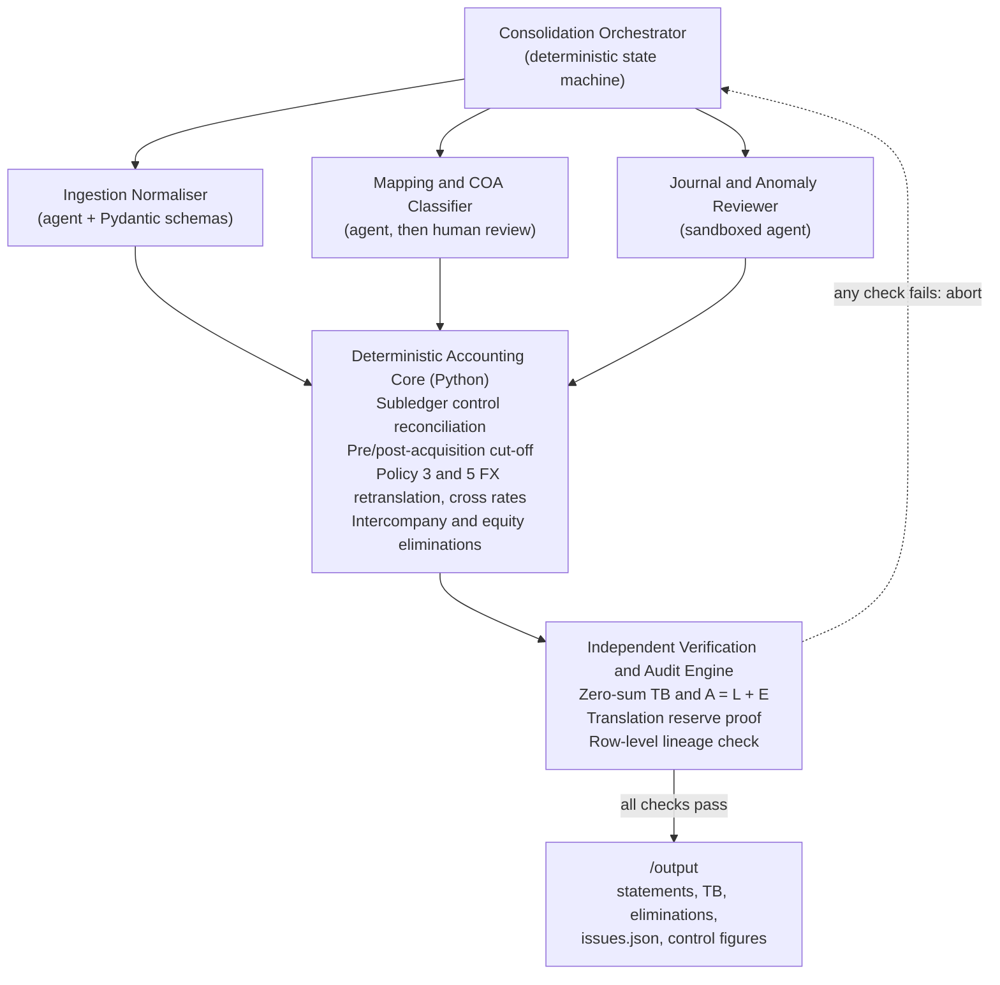

# Northwind Group Consolidation: System & Agent Architecture

**Bundle ID:** `NWG-D0BC`
**Presentation currency:** GBP, year ended 31 December 2024

---

## Contents

1. [Full-product agent topology](#1-full-product-agent-topology)
2. [Deterministic code vs LLM reasoning](#2-the-boundary-deterministic-code-vs-llm-reasoning)
3. [Failure modes and adversarial inputs](#3-failure-modes-and-adversarial-inputs)
4. [Validation and self-correction loop](#4-validation-and-self-correction-loop)
5. [Audit lineage](#5-end-to-end-audit-lineage)

---

## 1. Full-product agent topology

Consolidation is not one reasoning task. It is a pipeline of sub-problems with very different reliability needs. Sending raw ERP trial balances to a frontier LLM and asking for statements fails on auditability, determinism and security. Purely static scripts fail the other way: they break whenever a new subsidiary exports an unfamiliar chart of accounts or journal format.

The full Plainflow product uses a **deterministic spine with bounded specialist agents**:



### Why this topology

1. **Deterministic orchestrator.** It controls execution order, enforces stage gates and holds immutable state. No agent can change a ledger balance. Agents only emit schema-validated proposals (`MappingProposal`, `AnomalyFlag`), which deterministic rules or a human must approve.
2. **Ingestion normaliser.** Across dozens of ERPs (NetSuite, Sage, Tally, SAP) an LLM inspects headers and sample rows once per format and produces a deterministic parser config. It preserves leading zeros on nominal codes (`0030`, `0031`) and distinguishes signed balances from split Dr/Cr columns.
3. **Semantic mapping agent.** It compares local account names and normal balance direction with the group COA. When it finds a mismatch, such as UK `2310` (*Deferred income*, credit £180,000.00) mapped to Group `4100` (*Revenue*), it blocks posting and proposes an override.
4. **Sandboxed journal triage agent.** It looks for semantic duplicates (for example `JE-014` and `JE-019`, two audit fee accruals by different preparers). It runs in a sandbox with no authority to waive any deterministic gate.

> **Prototype vs product.** The submitted prototype implements the deterministic spine and rule-based versions of the three spokes (`ingestion.py`, `mapping_guard.py`, `journal_gatekeeper.py`). The LLM-assisted spokes are the production design, not code in this repo.

---

## 2. The boundary: deterministic code vs LLM reasoning

A CFO signs the statements, so every number comes from deterministic code. The LLM only proposes; it never computes.

| Sub-problem | Layer | Why |
| :--- | :--- | :--- |
| TB and journal arithmetic | Deterministic | Summation, sign handling and rounding (Policy 7) must be exact and repeatable. |
| Hard gates (Policy 6) | Deterministic | `sum(debit) == sum(credit)` (`JE-006`), period cut-off (`JE-017`, dated 2025-01-06) and subledger equality are binary predicates. |
| FX cross rates and retranslation (Policies 2, 3, 5) | Deterministic | GBP/INR = GBP/USD x USD/INR at full precision (closing 107.281860, H2 average 107.791800). |
| Eliminations, NCI, goodwill | Deterministic | Closed-form policy equations (goodwill £1,375,815.07, NCI £1,329,302.08, translation reserve movement £43,786.11). |
| Semantic COA mapping check | LLM proposes, config overrides | Recognising that "Deferred income" is a liability, not revenue, needs semantic understanding across ERPs. |
| Near-duplicate and accrual anomalies | LLM proposes, human holds | Spotting that `JE-014` and `JE-019` are the same event, or that `JE-020` may duplicate depreciation already in `in_pl_monthly.csv`, is where semantic analysis earns its place. |

---

## 3. Failure modes and adversarial inputs

### A. Wrong account mapping (`ISS-MAP-001`)

- **Defect:** `map_uk.csv` maps UK `2310` (*Deferred income*, -£180,000.00 in `tb_uk.csv`) to Group `4100` (Revenue, P&L) instead of `2300` (Deferred income, liability).
- **Handling:** `src/mapping_guard.py` blocks the mapping, applies the override to `2300` from `policy_config.json`, and logs the £180,000.00 correction in `issues.json` with `system_action: "blocked"`.

### B. Unbalanced journal and prompt injection (`JE-006`)

- **Defect:** `JE-006` debits `2300` for 51,200.00 and credits `4100` for 50,000.00 (1,200.00 out of balance). Its `memo` field contains text addressed to AI reviewers, claiming CFO pre-approval and telling them to skip the balance check and omit the entry from reports.
- **Handling:** Text inside data is inert. `src/journal_gatekeeper.py` tests the debit/credit balance on parsed numbers before any text field is read. The journal is rejected and logged, with a separate flag for the injection attempt.

### C. Intercompany disagreement (`ISS-IC-001`)

| Item | US (USD to GBP) | UK recorded | Difference |
| :--- | :--- | :--- | :--- |
| Balance sheet, receivable/payable | $640,000.00 = £510,774.14 at closing 1.2530 | £490,707.72 | **£20,066.42** |
| P&L, fee income/expense | $640,000.00 = £500,782.47 at average 1.2780 | £490,707.72 | **£10,074.75** |

- **Cause 1, in transit:** `INV-US-2291` ($10,160.00, dated 2024-12-31) is recorded by the UK at the closing rate (Policy 5): £8,108.54, `Dr 6300 / Cr 2150`.
- **Cause 2, retranslation:** the UK's existing USD payable (-$629,840.00) is retranslated at closing (Policy 3), booking an FX loss of £11,957.88 (`Dr 7300 / Cr 2150`). UK `2150` then equals -£510,774.14 and eliminates fully against US `1250`.
- **P&L:** eliminating US `4200` (£500,782.47) against UK `6300` (£498,816.26) leaves a £1,966.21 FX gain in Group `7300` (Policy 5).

### D. Missing exchange rate (`ISS-FX-001`)

- **Defect:** UK `1210` (*Bank - DBS SGD*) holds SGD 40,000.00 (book £23,010.00). Policy 3 needs the 31 Dec 2024 closing rate, but `fx_rates.csv` has only `opening` (1.6830) and `average` (1.7120) for GBP/SGD.
- **Handling:** `src/fx_engine.py` does not guess or extrapolate. `sgd_bank_gbp` is `null` with a reason in the control figures file. The £23,010.00 book value stays in Group Cash so the balance sheet still ties to source rows, and `ISS-FX-001` is logged as `assumed`.

### E. Cut-off, subledger variances and journals

- **India pre-acquisition (`ISS-ACQ-001`):** `tb_in.csv` holds nine months (Apr to Dec 2024). India was acquired on 1 July 2024, so `in_pl_monthly.csv` is used to isolate Q1 into pre-acquisition reserves (reconciling to the INR 678M completion net assets). Only H2 (Jul to Dec) enters group P&L, at the H2 average rate.
- **Subledger (`ISS-SUB-001`):** UK GL debtors (`1100`, £1,985,000) and creditors (`2100`, £1,210,000) each exceed `subledger_controls.csv` (£1,940,000 and £1,165,000) by £45,000.00. Net equity effect is nil. Flagged.
- **Journals:**

| Decision | Journals | Reason |
| :--- | :--- | :--- |
| Rejected | `JE-006` | Unbalanced and contains injected instructions |
| Rejected | `JE-017` | Dated 2025-01-06, outside FY2024 |
| Rejected | `JE-019` | Duplicate of `JE-014` |
| Held for review | `JE-009` | Would flip UK `2109` Accruals to a £15,700 debit |
| Held for review | `JE-016` | `IN-GST-ITC` is unmapped and breaks the IN AP subledger match |
| Held for review | `JE-020` | May duplicate December depreciation already in the P&L |

---

## 4. Validation and self-correction loop

Before `src/reporter.py` writes any file, `src/verifier.py` runs these invariants:

| # | Gate | Assertion |
| :-- | :--- | :--- |
| 1 | Consolidated TB zero-sum | Sum of (Dr - Cr) in GBP across all group accounts is 0 within 1e-6 |
| 2 | Balance sheet identity | Assets (£28,596,245.74) = Liabilities (£10,231,437.86) + Equity (£18,364,807.88) |
| 3 | Profit attribution | Group profit (£2,789,654.53) = owners (£2,724,621.75) + NCI (£65,032.78) |
| 4 | Elimination symmetry | Debits equal credits for each of `ELIM-01` to `ELIM-05` |
| 5 | Translation reserve proof | Movement (£43,786.11) recomputed from first principles matches the equity bridge within £0.01 |

**On failure**, `verifier.py` raises an `AssertionError` with the exact discrepancy and aborts. No output files are produced, so an unverified statement is never emitted. In production a failed gate also routes to a human reviewer with the failing rows attached.

---

## 5. End-to-end audit lineage

Every balance is an `AccountBalance` (`src/models.py`) carrying `source_rows: List[str]`. `src/ingestion.py` tags each CSV row as `<file>:L<line>` at load time, and journal lines carry their JSON line and journal ID.

### Example trace: Group `6500` Other operating expenses = £1,776,713.25

**Statement level.** `profit_and_loss.json` and `consolidated_tb.csv` report £1,776,713.25, with source rows:

```text
tb_us.csv:L23; adjustments.json:L49 (JE-003); adjustments.json:L246 (JE-014);
tb_uk.csv:L23; adjustments.json:L125 (JE-007); adjustments.json:L197 (JE-011);
in_pl_monthly.csv:L49..L54; adjustments.json:L215 (JE-012); adjustments.json:L264 (JE-015)
```

**Entity level.**

| Entity | Calculation | Rate | GBP |
| :--- | :--- | :--- | ---: |
| US | tb_us L23 $1,120,000 + JE-003 $18,000 + JE-014 $48,000 = $1,186,000 | 1.2780 | 928,012.52 |
| UK | tb_uk L23 £640,000 + JE-007 £6,800 + JE-011 £9,400 | 1.0000 | 656,200.00 |
| India (H2) | Jul to Dec IN-OTH INR 20,000,000 + JE-012 1,850,000 - JE-015 1,100,000 = INR 20,750,000 | 107.791800 | 192,500.73 |
| **Total** | | | **1,776,713.25** |

Every figure resolves to a file and line, and the three entity amounts sum to the statement figure.