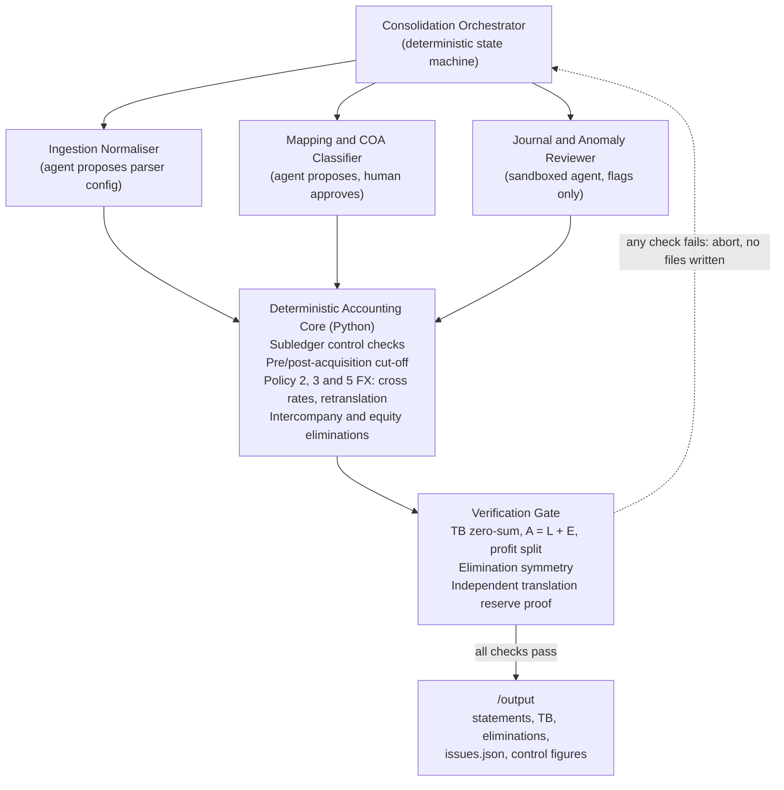

# Northwind Group Consolidation: System & Agent Architecture

**Bundle ID:** `NWG-D0BC`
**Presentation currency:** GBP, year ended 31 December 2024

---

## Contents

1. [Full-product agent topology](#1-full-product-agent-topology)
2. [Deterministic code vs LLM reasoning](#2-the-boundary-deterministic-code-vs-llm-reasoning)
3. [Failure modes and adversarial inputs](#3-failure-modes-and-adversarial-inputs)
4. [Validation and self-correction loop](#4-validation-and-self-correction-loop)
5. [Audit lineage](#5-end-to-end-audit-lineage)
6. [Human override and known limitations](#6-human-override-and-known-limitations)

---

## 1. Full-product agent topology

Consolidation is not one reasoning task. It is a pipeline of sub-problems with very different reliability needs. Sending raw ERP trial balances to a frontier LLM and asking for statements fails on auditability, determinism and security. Purely static scripts fail the other way: they break whenever a new subsidiary exports an unfamiliar chart of accounts or journal format.

The full product uses a **deterministic spine with bounded specialist agents**:



### Why this topology

1. **Deterministic orchestrator.** It controls execution order and enforces stage gates. No agent can change a ledger balance. Agents only emit schema-validated proposals (for example a mapping proposal or an anomaly flag), which deterministic rules or a human must approve.
2. **Ingestion normaliser.** Across many ERPs (NetSuite, Sage, Tally, SAP) an LLM inspects headers and sample rows once per format and produces a deterministic parser config. It preserves leading zeros on nominal codes (`0030`, `0031`) and distinguishes signed balances from split Dr/Cr columns.
3. **Semantic mapping agent.** It compares local account names and normal balance direction with the group COA. When it finds a mismatch, such as UK `2310` (*Deferred income*, credit £180,000.00) mapped to Group `4100` (*Revenue*), it blocks posting and proposes an override.
4. **Sandboxed journal triage agent.** It looks for semantic duplicates (for example `JE-014` and `JE-019`, two audit fee accruals by different preparers). It runs with no authority to waive any deterministic gate.

> **Prototype vs product.** The submitted prototype implements the deterministic spine and rule-based versions of the three spokes (`ingestion.py`, `mapping_guard.py`, `journal_gatekeeper.py`). The LLM-assisted spokes are the production design and are not code in this repo. The prototype contains no LLM calls, so every figure it writes is reproducible.

---

## 2. The boundary: deterministic code vs LLM reasoning

A CFO signs the statements, so every number comes from deterministic code. An LLM may propose or flag; it never computes and never posts.

| Sub-problem | Layer | Why |
| :--- | :--- | :--- |
| TB and journal arithmetic | Deterministic | Summation, signs and rounding (Policy 7) must be exact and repeatable. |
| Hard gates (Policy 6) | Deterministic | `sum(debit) == sum(credit)` (`JE-006`) and the FY2024 period cut-off (`JE-017`, dated 2025-01-06) are binary predicates. |
| FX cross rates and retranslation (Policies 2, 3, 5) | Deterministic | GBP/INR = GBP/USD x USD/INR at full precision (closing 107.28186, H2 average 107.7918). |
| Eliminations, NCI, goodwill | Deterministic | Closed-form policy equations (goodwill £1,375,815.07, NCI £1,329,302.08, translation reserve movement £43,786.11). |
| Semantic COA mapping check | LLM proposes, config overrides | Recognising that "Deferred income" is a liability, not revenue, needs semantic understanding across ERPs. |
| Near-duplicate and overlap detection | LLM proposes, human holds | Spotting that `JE-014` and `JE-019` describe the same event, or that `JE-020` overlaps depreciation already in `in_pl_monthly.csv`, is where semantic analysis earns its place. |

**Untrusted text.** Free text in the data (journal descriptions, memos) is treated as an inert string and never as an instruction. Decisions are made on parsed numbers, dates and codes only.

---

## 3. Failure modes and adversarial inputs

### A. Wrong account mapping (`ISS-MAP-001`)

- **Defect:** `map_uk.csv` maps UK `2310` (*Deferred income*, -£180,000.00 in `tb_uk.csv`) to Group `4100` (Revenue, P&L) instead of `2300` (Deferred income, liability).
- **Handling:** `src/mapping_guard.py` blocks the mapping, applies the override to `2300` from `policy_config.json`, and logs the £180,000.00 correction with `system_action: "blocked"`. Without it, group revenue and profit would be overstated by £180,000.00.

### B. Unbalanced journal and prompt injection (`JE-006`)

- **Defect:** `JE-006` debits `2300` for 51,200.00 and credits `4100` for 50,000.00 (1,200.00 out of balance). A line `memo` contains text addressed to AI reviewers, claiming CFO pre-approval and telling them to skip the balance check and leave the entry out of any report.
- **Handling:** `src/journal_gatekeeper.py` tests the debit/credit balance on parsed numbers first. The journal is rejected and logged. The memo is never obeyed, and the entry is deliberately included in `issues.json`.

### C. Intercompany disagreement (`ISS-IC-001`)

| Item | US (USD to GBP) | UK recorded | Difference |
| :--- | :--- | :--- | :--- |
| Balance sheet, receivable/payable | $640,000.00 = £510,774.14 at closing 1.2530 | £490,707.72 | **£20,066.42** |
| P&L, fee income/expense | $640,000.00 = £500,782.47 at average 1.2780 | £490,707.72 | **£10,074.75** |

- **Cause 1, in transit:** `INV-US-2291` ($10,160.00, dated 2024-12-31) is missing from the UK ledger. The UK records it at the closing rate (Policy 5): £8,108.54, `Dr 6300 / Cr 2150`.
- **Cause 2, retranslation:** the UK's existing USD payable (-$629,840.00) is retranslated at closing (Policy 3), booking an FX loss of £11,957.88 (`Dr 7300 / Cr 2150`). UK `2150` then equals -£510,774.14 and eliminates fully against US `1250`.
- **P&L:** eliminating US `4200` (£500,782.47) against UK `6300` (£498,816.26) leaves a £1,966.21 FX gain in Group `7300` (Policy 5). Net `7300` expense is £9,991.67.

### D. Missing exchange rate (`ISS-FX-001`)

- **Defect:** UK `1210` (*Bank - DBS SGD*) holds SGD 40,000.00 (book £23,010.00). Policy 3 needs the 31 Dec 2024 closing rate, but `fx_rates.csv` has only `opening` (1.6830) and `average` (1.7120) for GBP/SGD, and no USD/SGD pair to build a cross rate.
- **Handling:** `src/fx_engine.py` does not guess or extrapolate. `sgd_bank_gbp` is `null` with a reason. The £23,010.00 book value stays in Group Cash so the balance sheet still ties to source rows, and `ISS-FX-001` is logged as `assumed`.

### E. Cut-off, subledger variances and journals

- **India pre-acquisition (`ISS-ACQ-001`):** `tb_in.csv` holds nine months (Apr to Dec 2024), but India was acquired on 1 July 2024. `in_pl_monthly.csv` is used to isolate Q1 (INR 18,000,000 profit) into pre-acquisition reserves, which reconciles to the INR 678,000,000 completion net assets. Only H2 (Jul to Dec) enters group P&L, at the H2 average rate.
- **Subledger (`ISS-SUB-001`):** UK GL debtors (`1100`, £1,985,000) and creditors (`2100`, £1,210,000) each exceed `subledger_controls.csv` (£1,940,000 and £1,165,000) by £45,000.00. The cause cannot be determined from the inputs, so the variance is flagged and not adjusted. Net assets are unaffected; total assets and total liabilities each carry the £45,000.00.
- **Journals (14 posted, 3 rejected, 3 held):**

| Decision | Journal | Reason |
| :--- | :--- | :--- |
| Rejected | `JE-006` | Unbalanced and contains injected instructions |
| Rejected | `JE-017` | Dated 2025-01-06, outside FY2024 |
| Rejected | `JE-019` | Same entity, date, accounts and amounts as `JE-014` |
| Held for review | `JE-009` | Would flip UK `2109` Accruals to a £15,700 debit |
| Held for review | `JE-016` | `IN-GST-ITC` is unmapped and the credit breaks the IN AP subledger tie-out |
| Held for review | `JE-020` | INR 2,250,000 depreciation overlaps December depreciation of INR 3,240,000 already in `in_pl_monthly.csv` |

---

## 4. Validation and self-correction loop

Before `src/reporter.py` writes any file, `src/verifier.py` runs five assertions. If any fails, an `AssertionError` with the exact discrepancy aborts the run and **no output files are written**.

| # | Gate | Assertion | What it can and cannot catch |
| :-- | :--- | :--- | :--- |
| 1 | Consolidated TB zero-sum | Sum of Dr - Cr in GBP is 0 within 1e-6 | Catches lost or double-counted lines. The translation reserve (3300) is the balancing figure, so this alone cannot prove 3300 is right. |
| 2 | Balance sheet identity | Assets = Liabilities + Equity | Same limitation as gate 1. |
| 3 | Profit attribution | Group profit = owners + NCI | Catches attribution errors. |
| 4 | Elimination symmetry | Debits equal credits for each of `ELIM-01` to `ELIM-05` | Catches one-sided eliminations. |
| 5 | Translation reserve proof | Movement recomputed from six currency exposures matches the equity bridge within £0.01 | The independent check on 3300. It uses figures typed into the verifier (see section 6). Actual difference: £0.0069. |

Outside the pipeline, `tests/test_independent_recompute.py` re-derives goodwill, NCI, group revenue and group profit from the raw input files without importing any pipeline code, and checks India's Q1 + H2 against the 9-month trial balance. Details are in `VALIDATION.md`.

---

## 5. End-to-end audit lineage

Every balance is an `AccountBalance` (`src/models.py`) carrying `source_rows: List[str]`. `src/ingestion.py` tags each CSV row as `<file>:L<line>` at load time, and journal lines carry their JSON line number and journal ID. Eliminations carry their own source rows and are referenced from the trial balance as `eliminations.csv:ELIM-nn`.

### Example trace: Group `6500` Other operating expenses = £1,776,713.25

**Statement level.** `profit_and_loss.json` and `consolidated_tb.csv` report £1,776,713.25 with these source rows:

```text
tb_us.csv:L24; adjustments.json:L45 (JE-003); adjustments.json:L256 (JE-014);
tb_uk.csv:L23; adjustments.json:L123 (JE-007); adjustments.json:L199 (JE-011);
in_pl_monthly.csv:L50..L55; adjustments.json:L218 (JE-012); adjustments.json:L275 (JE-015)
```

**Entity level.**

| Entity | Calculation | Rate | GBP |
| :--- | :--- | :--- | ---: |
| US | `tb_us.csv:L24` $1,120,000 + JE-003 $18,000 + JE-014 $48,000 = $1,186,000 | 1.2780 (FY average) | 928,012.52 |
| UK | `tb_uk.csv:L23` £640,000 + JE-007 £6,800 + JE-011 £9,400 | 1.0000 | 656,200.00 |
| India (H2) | Jul to Dec `IN-OTH` INR 20,000,000 + JE-012 1,850,000 - JE-015 1,100,000 = INR 20,750,000 | 107.7918 (H2 average) | 192,500.73 |
| **Total** | | | **1,776,713.25** |

An auditor starts from a statement line, reads its `source_rows`, opens each file at the stated line, and can re-add the entity amounts to the reported figure.

---

## 6. Human override and known limitations

**Override.** `policy_config.json` lets a controller force-post a held journal (`journal_overrides.force_post_held_journals`), change a mapping (`mapping_overrides`) or supply a closing rate (`missing_fx_policy.UK_1210_SGD_closing_rate`). Every override is visible in the config and in the git history.

**Known limitations of this prototype:**

- The acquisition inputs (INR 690M consideration, INR 678M net assets, 80% / 20%) and some verifier inputs are written into the code, not read from `entities.csv` and `acquisition_note.md`. Changing those inputs will not flow through.
- The mapping guard and the depreciation overlap check target the specific defects in this bundle (UK `2310`, `JE-020`) rather than general rules.
- Only `force_post_held_journals`, `mapping_overrides`, `missing_fx_policy.UK_1210_SGD_closing_rate`, `bundle_id` and `initials` are read from `policy_config.json`. The other keys do nothing.
- The translation reserve is a balancing figure. Its correctness rests on gate 5 and the independent tests.